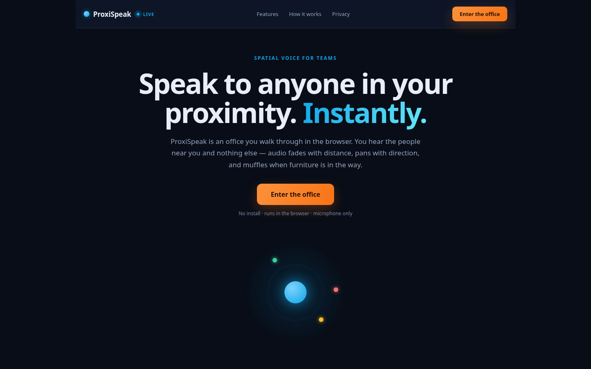
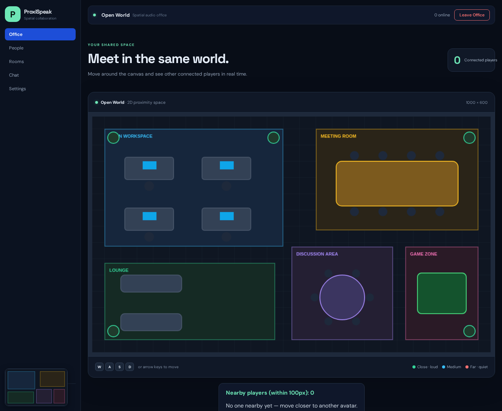
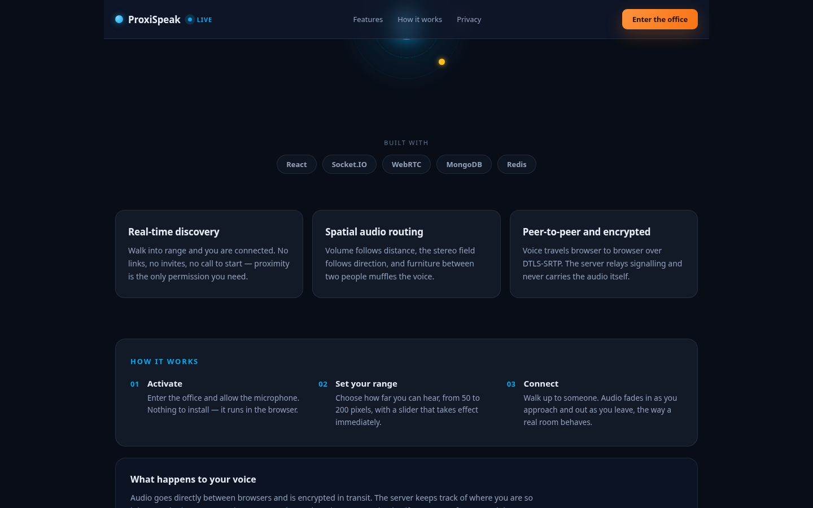
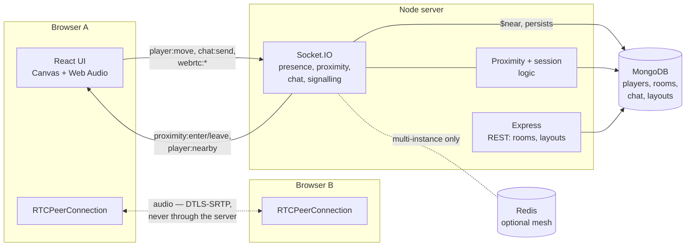
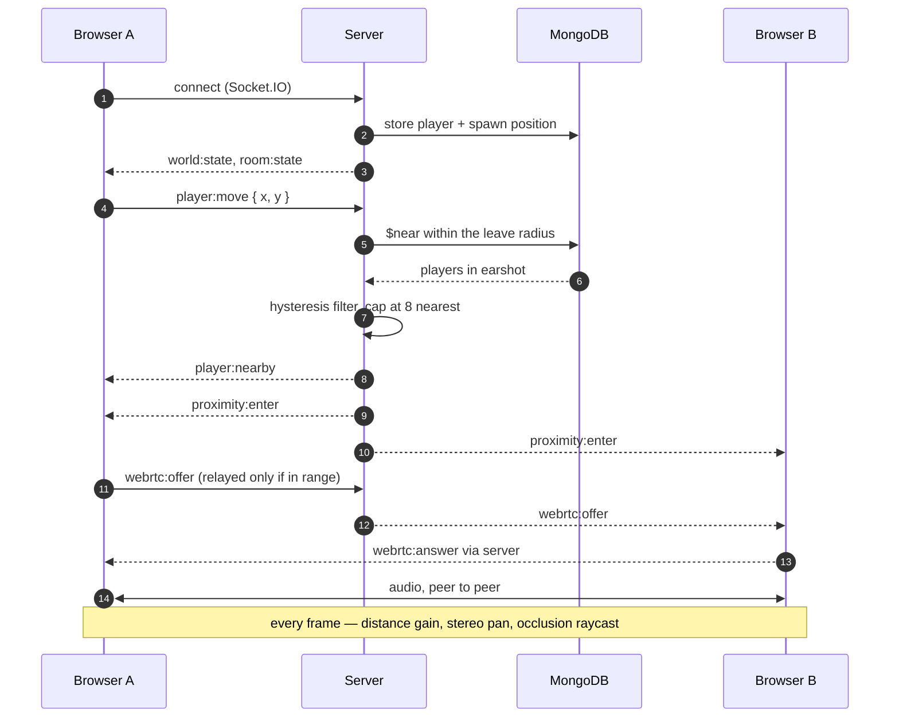

# ProxiSpeak — Geospatial Proximity Audio Ecosystem

A real-time virtual office you walk through in the browser. You hear the people near
you and nothing else — audio fades with distance, pans with direction, and muffles
when furniture sits between two avatars.

**React · Vite · HTML5 Canvas · Web Audio API · WebRTC · Node.js · Express ·
Socket.IO · MongoDB (geospatial) · optional Redis**



---

## 1. Overview

An always-on call is the wrong model for a team: everyone hears everyone, so nobody
talks. ProxiSpeak restores what a real office has — you hear the people at your
desk, not the people two rooms away, and moving closer is how a conversation
starts.

You move an avatar around a shared 2D office. Everyone within your listening radius
is connected to you by a peer-to-peer audio stream. Walk away and the connection
closes. Furniture in the way muffles the voice. Rooms scope who you can hear and
who you can talk to.

---

## 2. Screenshots

| Landing | Office |
|---|---|
|  |  |



---

## 3. What's built

**Movement and presence**

- Canvas world, 1000 × 600, with labelled zones and furniture
- Keyboard movement (WASD / arrow keys) at 240 px/s with furniture collision
- **Click to walk** — click anywhere and the avatar walks there, sliding along
  furniture and giving up when a destination is unreachable
- Non-overlapping spawn slots, so avatars never stack on arrival
- Live online count and a people list with speaking indicators

**Proximity**

- MongoDB `$near` on a `2d` geospatial index — one query per move, not a loop
- Listening radius of 100 px by default, **adjustable 50–200 px** per listener
- **Hysteresis**: connect at the radius, disconnect at 1.15× it, so standing on the
  boundary does not tear down and rebuild the connection
- `proximity:enter` / `proximity:leave` to both sides, plus a `player:nearby` list
- Distance in world pixels shown beside each nearby player
- Capped at the **eight nearest peers** — a full mesh does not scale

**Audio**

- WebRTC peer connections with offer/answer and ICE buffering
- Distance attenuation and stereo panning in one mixer loop
- **Sound occlusion**: furniture between two players drops gain to 35 % and closes
  a low-pass to 800 Hz, tested with Liang–Barsky segment-versus-rectangle
- Microphone mute/unmute, live level meters, microphone and speaker pickers
- Optional TURN relay for peers behind symmetric NATs

**Rooms and conversation**

- Three spaces (Open World, Meeting Room, Lounge) scoping proximity, audio and chat
- **Meeting Room call** that works regardless of distance, with a participant list
- **Raise hand** and **emoji reactions** inside the call
- Chat with **room and global scopes**, typing indicators and unread counts
- Chat history persisted in MongoDB
- **Screen sharing** into the Meeting Room
- Activity feed for joins, leaves and people coming into earshot

**Platform**

- Room layouts persisted in MongoDB, served by `GET /api/rooms/:id/layout`
- Strict validation on every layout read; startup repairs layouts seeded under
  older furniture names
- Optional Redis adapter for multi-instance deployments, failing soft without it
- Rate limiting, configurable CORS, graceful shutdown, global error handling
- Pooled MongoDB connection with a guard against concurrent connects
- Minimap, ring legend, app shell with sidebar navigation
- Dockerfile, environment examples and a Render deployment guide

---

## 4. Architecture



**Three layers, each doing one job.** The server owns truth — who is connected,
where they are, which room they are in, who can hear whom. The browser owns
rendering and audio. WebRTC carries the voice directly between peers; the server
only relays signalling, which keeps it cheap and the latency low.

**Why the database does the proximity work.** A `$near` query against an indexed
position answers "who is within earshot" in one call. Filtering every player in
application code would not extend past a handful of people.

---

## 5. Workflow



**Step by step**

1. **Enter.** A socket connects; the server assigns a free spawn slot and stores the
   player with a `location: [x, y]` field.
2. **Move.** The client moves locally and broadcasts `player:move` (throttled to
   ~40 ms). The server clamps, persists and broadcasts `player:moved`.
3. **Find who is near.** The server runs `$near` within the listener's leave radius,
   filters by hysteresis, keeps the eight nearest, and emits `player:nearby` plus
   `proximity:enter` / `proximity:leave` to both sides.
4. **Connect the audio.** The two browsers exchange offer, answer and ICE through
   the server, which relays them only between players actually in range.
5. **Mix it.** Each frame, one loop per peer updates gain from distance, pan from
   direction, and a low-pass when furniture blocks the line between them.

---

## 6. Tech stack

| Layer | Choice | Why |
|---|---|---|
| Client | React + Vite | Component model for panels; Vite for a fast build |
| World | HTML5 Canvas | Hundreds of shapes per frame without DOM overhead |
| Audio | Web Audio API | Per-peer gain, panner and filter nodes in one graph |
| Voice | WebRTC | Peer-to-peer media — the server never carries audio |
| Transport | Socket.IO | Rooms, acknowledgements, automatic reconnection |
| Data | MongoDB | `$near` on a `2d` index answers proximity in one query |
| Scale | Redis (optional) | Adapter lets several instances share rooms and events |

---

## 7. Project structure

```
.
├── client/                 React application
│   ├── src/
│   │   ├── App.jsx         Shell, world render loop, panels
│   │   ├── Landing.jsx     Marketing page
│   │   ├── office.js       Built-in layout, accessors
│   │   ├── occlusion.js    Segment/rect geometry for blocked audio
│   │   ├── minimap.js      Minimap drawing and scale maths
│   │   ├── cursor.js       Pointer → world mapping
│   │   ├── useVoiceChat.js WebRTC + spatial mixer
│   │   ├── useScreenShare.js
│   │   ├── useRoomLayout.js
│   │   ├── useAudioDevices.js
│   │   ├── activity.js, typingIndicators.js, unreadMessages.js
│   │   └── *.test.js       Unit tests
│   └── tests/              Smoke harness (jsdom + esbuild)
├── server/
│   ├── index.js            Entry: HTTP, Socket.IO, startup
│   ├── chat.js             Chat handlers
│   ├── chatTyping.js       Typing indicators
│   ├── roomHandler.js      Room join/leave
│   ├── roomUtils.js        Room channels and emits
│   ├── lib/                Pure, testable modules
│   │   ├── session.js      Proximity diff, spawn, clamping
│   │   ├── proximity.js    Radius and hysteresis maths
│   │   ├── rooms.js        Room names, channels
│   │   ├── layouts.js      Room layout store and validation
│   │   ├── meeting-call.js Call membership and signalling rules
│   │   ├── meeting-events.js Raise hand, reactions
│   │   ├── screen-share.js Screen sharing
│   │   ├── mesh.js         Optional Redis adapter
│   │   ├── db.js           Pooled, guarded connection
│   │   ├── activity.js     Presence notifications
│   │   ├── chat.js         Chat message creation and routing
│   │   └── rate-limit.js
│   ├── tests/              Server test suites
│   ├── audit.js            Spatial benchmark against MongoDB
│   ├── spatial-benchmark.js Benchmark without a database
│   └── Dockerfile
└── docs/                   Review packs, roadmap, testing guide, images
```

---

## 8. Data model

**`players`**

| Field | Type | Notes |
|---|---|---|
| `socketId` | string | Socket.IO connection id |
| `name` | string | Display name |
| `avatarColor` | string | Hex colour |
| `room` | string | Room name — scopes proximity and chat |
| `roomId` | string | Room id — scopes presence and channels |
| `x`, `y` | number | Position in the 1000 × 600 world |
| `location` | `[x, y]` | Geospatial point, `2d` index, `min: 0`, `max: 1000` |
| `connected` | boolean | Current connection state |

**`rooms`** — `_id`, `name`, `layout { zones, furniture, plants }`
**`chatMessages`** — `_id`, `messageId`, `senderId`, `name`, `roomId`, `text`,
`timestamp`, `clientMessageId` (unique per sender, so a retry cannot duplicate)

---

## 9. Realtime events

**Client → Server**

| Event | Payload |
|---|---|
| `room:join` | Room id; callback returns success or error |
| `player:setName` / `player:setStatus` / `player:setAvatarColor` | Profile |
| `player:setRadius` | Listening radius in pixels, clamped 50–200 |
| `player:move` | `{ x, y }` |
| `chat:send` | Text, client message id, optional scope, callback |
| `chat:typing` | `{ isTyping }` — never carries message text |
| `meeting:join` / `meeting:leave` | Call membership |
| `meeting:hand` / `meeting:reaction` | `{ raised }` / `{ emoji }` |
| `screen:start` / `screen:stop` / `screen:watch` / `screen:offer` / `screen:answer` / `screen:ice-candidate` / `screen:list` | Screen sharing |
| `webrtc:offer` / `webrtc:answer` / `webrtc:ice` | Target peer and signal |

**Server → Client**

| Event | Payload |
|---|---|
| `world:state` | Array of players |
| `player:joined` / `player:moved` / `player:left` / `player:renamed` | Player or id |
| `player:nearby` | Array of nearby players with distance |
| `proximity:enter` / `proximity:leave` | Peer, or peer id |
| `chat:message` / `chat:history` | Room or global message / persisted history |
| `chat:typing` | Room-scoped typing status |
| `meeting:participant-joined` / `meeting:participant-left` | Participant |
| `meeting:hand` / `meeting:reaction` | `{ id, name, raised }` / `{ id, name, emoji }` |
| `activity` | Presence notification |
| `players:count` | Global connected count |

---

## 10. Getting started

**Requirements:** Node 20+, MongoDB (local or Atlas).

```bash
# server
cd server
cp .env.example .env        # set MONGODB_URI
npm install
npm run dev                 # http://localhost:3000

# client (second terminal)
cd client
cp .env.example .env        # set VITE_SERVER_URL
npm install
npm run dev                 # http://localhost:5173
```

Open **two windows**, set different names, and walk toward each other. The dev
server binds to `0.0.0.0`, so you can also open it from another device on your
network — which is the quickest way to test real WebRTC between two machines.

**Scripts**

| Command | Does |
|---|---|
| `npm run dev` (server) | Start with nodemon |
| `npm run dev` (client) | Vite dev server |
| `npm test` (server) | 21 suites |
| `npm test` (client) | Unit tests, smoke and occlusion |
| `npm run audit` | Spatial benchmark against MongoDB |
| `npm run audit:local` | Same benchmark, no database needed |
| `npm run build` (client) | Static build to `client/dist` |

---

## 11. Testing

| Layer | What it covers |
|---|---|
| **21 server suites** | Proximity, sessions, rooms, chat, routing, layouts, radius, mesh, screen share, meeting events, contracts, database guards |
| **40 client unit tests** | Unread counts, typing, activity, minimap maths, cursor mapping |
| **20 smoke checks** | Renders the real app in jsdom: the landing mounts, the canvas gets a context, the office opens, controls exist |
| **14 occlusion checks** | Segment-versus-rectangle geometry, including corner touches and parallel lines |

Decisions live in pure functions and are tested directly: proximity gating, chat
routing, layout normalisation, radius clamping, meeting-event validation.

Two layers exist because unit tests were not enough:

- A **static contract test** compares what the server sends against what the client
  reads, and asserts every event the client emits has a handler. That class of bug
  shipped twice before the check existed.
- A **smoke harness** renders the real component tree in jsdom, because two client
  bugs passed every static check.

See [`docs/TESTING.md`](docs/TESTING.md) for how to run and extend them.

---

## 12. Deployment

**The client and server deploy separately** — the server is a long-running Node
process, the client is static files.

**Checklist**

1. **HTTPS is mandatory.** Browsers refuse microphone and screen capture outside a
   secure context.
2. **Set `CORS_ORIGIN`** to the deployed frontend origin, exactly.
3. **Set `VITE_SERVER_URL` at build time** — Vite bakes it in, so setting it after
   the build has no effect.
4. **Add a TURN relay** via `VITE_TURN_URL`, `VITE_TURN_USERNAME`,
   `VITE_TURN_CREDENTIAL`. STUN alone fails silently between networks.
5. **Point `MONGODB_URI`** at Atlas or a self-hosted instance, and allow the host's
   IP range.

**Server** — a `Dockerfile` is included:

```bash
docker build -t proxispeak-server ./server
docker run -p 3000:3000 \
  -e MONGODB_URI="mongodb+srv://..." \
  -e CORS_ORIGIN="https://app.example.com" \
  proxispeak-server
```

**Deploying the server to Render**

1. Connect the repository to Render.
2. Runtime **Node**, **Root Directory** `server`.
3. Build `npm ci`, start `npm start`.
4. Add `MONGODB_URI`, and `CORS_ORIGIN` set to the frontend URL.
5. Deploy and confirm `MongoDB connected successfully` in the logs.

Set variables in the dashboard rather than committing a `.env`. Then point the
frontend's `VITE_SERVER_URL` at the backend and rebuild.

**Several instances** — set `REDIS_URL` and the adapter attaches automatically.

---

## 13. Progress

| Week | Delivered |
|---|---|
| **1** | Socket.IO signalling, keyboard movement, furniture collision, MongoDB geospatial schema |
| **2** | `$near` proximity with hysteresis, WebRTC peer audio, microphone capture, mute |
| **3** | Distance attenuation and stereo panning in one mixer loop; optional Redis mesh with an eight-peer cap |
| **4** | Room layouts in MongoDB, sound occlusion, app shell, device pickers, minimap, adjustable radius |
| **Beyond** | Click to walk, landing page, activity feed, global chat, raise hand and reactions, screen sharing, pooled database connection |

---

## 14. Team

| Member | Role | Contribution |
|---|---|---|
| **Revanth** | Backend & integration lead | Signalling server, proximity, spatial mixer, occlusion, room persistence, Redis mesh, client integration, testing and deployment |
| **Vivek** | Frontend | Screen sharing, chat typing indicators, unread counts, global player count |
| **Naseema** | Features | Rooms and chat, meeting call, activity notifications, raise hand and reactions, deployment guide |
| **Janakirani** | Research | WebRTC research and testing report, connection and dev-server improvements |

---

## 15. Project information

| | |
|---|---|
| **Assignment** | ITS/WEB/1322 |
| **Repository** | [revanthofficial21/ProxiSpeak](https://github.com/revanthofficial21/ProxiSpeak) |
| **Branches** | `main` (integration), `revanth` (development) |
| **Documentation** | [Final review](docs/FINAL-REVIEW.md) · [Testing](docs/TESTING.md) · [Roadmap](docs/ROADMAP.md) · [WebRTC research](docs/WebRTC-Research.md) |
